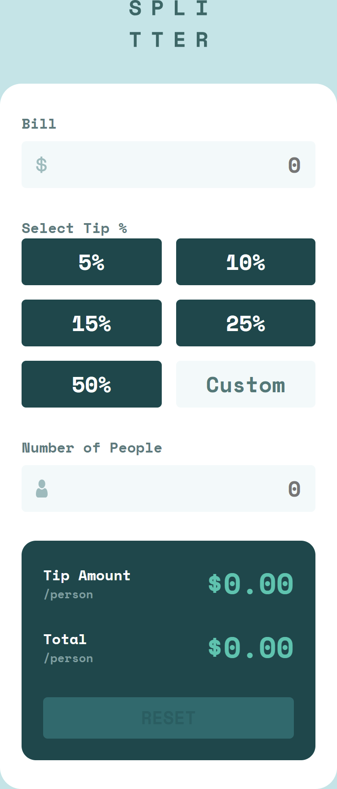
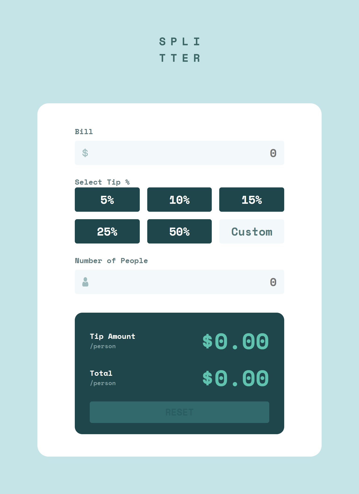
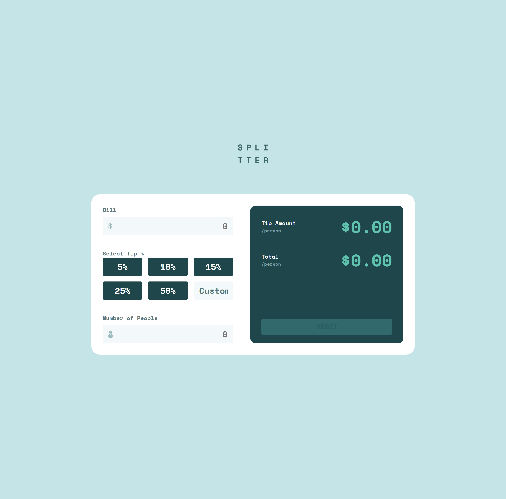

# Frontend Mentor - Tip Calculator App

A responsive tip calculator that calculates the tip amount and total bill per person based on the bill amount, selected tip percentage, and number of people.

This project was built as a solution to the [Frontend Mentor Tip Calculator App challenge](https://www.frontendmentor.io/challenges/tip-calculator-app-ugJNGbJUX).

## Table of Contents

- [Overview](#overview)
  - [The Challenge](#the-challenge)
  - [Features](#features)
  - [Screenshot](#screenshot)
  - [Links](#links) 
  - [Built With](#built-with)
  - [Project Structure](#project-structure)
  - [What I Learned](#what-i-learned)
  - [Challenges and Technical Decisions](#challenges-and-technical-decisions)
  - [Continued Development](#continued-development)
- [AI Collaboration](#ai-collaboration)
- [Author](#author)

## Overview

### The Challenge

Users should be able to:

- View the optimal layout depending on their device's screen size.
- See hover and focus states for interactive elements.
- Calculate the correct tip amount per person.
- Calculate the total bill per person.
- Select a predefined tip percentage or enter a custom percentage.
- Reset the calculator when needed.

### Features

- Responsive layout for mobile, tablet, and desktop screens.
- Predefined tip percentages (5%, 10%, 15%, 25%, and 50%).
- Custom tip percentage input.
- Real-time calculations as input values change.
- Input validation to prevent invalid calculations.
- Visual error feedback for invalid inputs.
- Dynamic reset button state based on calculation validity.
- Currency values displayed with two decimal places.

### Screenshot

<!-- Add your screenshot to the project root and update the path if necessary. -->





### Links

- Challenge: [Frontend Mentor - Tip Calculator App](https://www.frontendmentor.io/challenges/tip-calculator-app-ugJNGbJUX)

- Solution URL: https://github.com/promahmoud219/Tip-calculator-app

- Live Site URL: https://promahmoud219.github.io/Tip-calculator-app/


### Built With

- Semantic HTML5
- CSS3
- Sass (SCSS)
- Vanilla JavaScript (ES6+)
- CSS Custom Properties
- Flexbox
- CSS Grid
- Mobile-first responsive design
- BEM-inspired CSS naming conventions

### Project Structure

```text
tip-calculator-app/
│
├── images/
│
├── styles/
│   ├── abstracts/
│   ├── base/
│   ├── components/
│   ├── layout/
│   └── main.scss
│
├── design/
├── index.html
├── main.js
└── README.md
```

### What I Learned

Working on this project helped me strengthen my understanding of several frontend development concepts.

**1. JavaScript Functions and Separation of Concerns**

I organized the application logic into smaller functions, each responsible for a specific task:

- Retrieving input values.
- Validating input values.
- Performing calculations.
- Updating the UI.
- Managing the reset button state.

This made the code easier to understand, maintain, and extend.

**2. Input Validation**

I learned how to validate numeric inputs using `Number.isFinite()` and how to prevent calculations when the required values are invalid.

I also used guard clauses to stop execution early when validation fails.

**3. DOM Manipulation and Event Handling**

I practiced working with different DOM events, including `input`, `change`, and `focus`, to create an interactive calculator that responds to user actions.

**4. Sass Architecture**

I organized styles into separate Sass directories based on their responsibilities, including abstracts, base styles, components, and layout.

I also used Sass maps and mixins to centralize typography definitions and reduce repetition.

**5. Responsive Design**

I used CSS Grid and Flexbox with responsive breakpoints to create layouts that adapt to different screen sizes.

### Challenges and Technical Decisions

**Centralized Input Validation**

Instead of performing all validation checks inside the calculation function, I created separate validation functions for each input and a central `validateInputs()` function to coordinate them.

This separates individual validation rules from the overall calculation flow.

**Reusable Calculation Functions**

I separated the tip and total calculations into independent functions. This keeps the calculation logic independent of DOM manipulation.

**Dynamic Reset Button State**

I implemented separate functions to enable and disable the reset button depending on whether the input values are valid.

## Continued Development

There are several areas I plan to improve in future iterations:

- Centralize validation feedback and separate it from validation logic.
- Ensure the reset functionality clears all input values, error messages, and validation states.
- Improve hover and focus-visible states for all interactive controls.
- Review accessibility, including keyboard navigation and screen reader feedback.
- Remove unused functions and improve code consistency.
- Refine the project structure to keep Sass source files separate from generated CSS output.

## AI Collaboration

I used ChatGPT as a development assistant throughout this project.

My main use cases included:

- Reviewing JavaScript code and identifying potential bugs.
- Understanding JavaScript behavior, DOM properties, and event handling.
- Discussing separation of concerns and function responsibilities.
- Evaluating different implementation approaches and their trade-offs.
- Reviewing code quality, naming conventions, and maintainability.

I used AI primarily as a learning and code-review tool rather than relying on it to implement the entire solution.

## Author

- Frontend Mentor: https://www.frontendmentor.io/profile/promahmoud219
